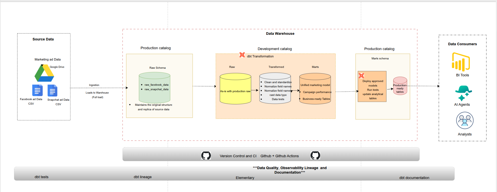
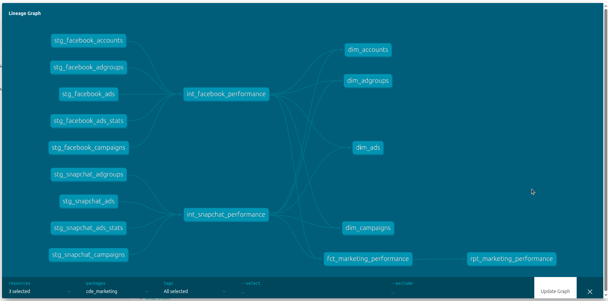
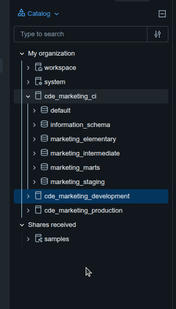
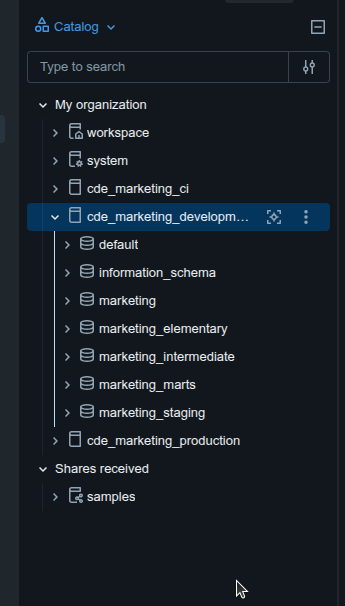
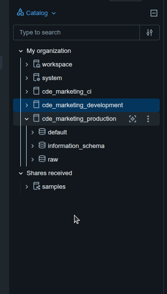
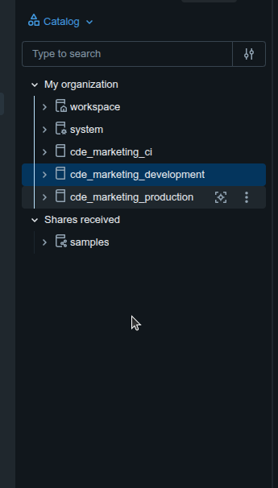

# Marketing Data Platform with Databricks & dbt

A production-minded data platform that brings Facebook Ads and Snapchat Ads performance data into one tested, documented analytical model.

## Project overview

Marketing teams often manage campaigns across several advertising platforms, each with different data structures and reporting interfaces. This project brings Facebook Ads and Snapchat Ads data into Databricks, standardizes it with dbt, and makes it available for consistent analysis of advertising spend, impressions, clicks, and campaign performance.

The goal is not simply to move files into a warehouse. It is to create a reliable, reusable data product with clear definitions, data quality checks, lineage, environment separation, and an automated validation workflow.

## Business problem and objectives

Without a shared model, marketers must access each platform separately or combine exported files manually. Different field names, identifier structures, and levels of detail make comparisons difficult. The resulting reports are harder to reuse and validate.

This platform aims to:

- Combine Facebook and Snapchat performance data into a consistent analytical structure.
- Support spend, impressions, clicks, CTR, CPC, CPM, and performance analysis over time.
- Preserve enough campaign and ad context to support meaningful drill-downs.
- Validate data through automated tests and reconciliation.
- Make the models understandable through dbt documentation and lineage.
- Separate development, CI, and production workloads, with secure production authentication.

## Architecture



**Implemented data flow:**

1. **Source:** Nine Facebook and Snapchat CSV files are retrieved from Google Drive.
2. **Ingestion:** A Python application retrieves the files, processes them in memory with pandas, and loads them as Delta tables into `cde_marketing_production.raw`.
3. **Transformation:** dbt reads the production raw sources and builds staging, intermediate, and analytical models. Development and CI write their results to their own catalogs.
4. **Quality and observability:** dbt tests validate the models; Elementary captures run and test information and monitors fact-table volume.
5. **Validation and promotion:** GitHub Actions runs the CI build on a pull request. Changes are merged after successful checks. Automated production deployment is planned but **not yet implemented**.
6. **Consumption:** The final models are designed for Databricks SQL, analysts, BI tools, and future analytical applications. BI/AI integrations are potential consumers, not deployed components.

> **Diagram clarification:** The diagram illustrates the intended end-to-end production promotion path. Its development-side raw area represents **read access to production raw data**, not a copied raw dataset. The production deployment stage is the next implementation step.

## Technology choices

| Component | Technology | Role |
|---|---|---|
| Source | Google Drive CSV files | Supplied advertising datasets |
| Ingestion | Python, pandas | Retrieve and load data without a local file-staging layer |
| Storage and processing | Databricks, Delta tables | Governed raw and analytical data |
| Transformation | dbt with Databricks adapter | SQL models, tests, documentation, lineage |
| Governance | Unity Catalog | Catalogs, schemas, access controls |
| Observability | Elementary | Test history, model health, volume monitoring |
| Version control and CI | Git, GitHub Actions | Review and automatically validate changes |

### Why Python ingestion?

The implementation uses Python to retrieve the files from Google Drive and load them into Databricks. The application processes files in memory using pandas instead of keeping an additional staging copy on the Ubuntu machine. Airbyte was considered as an alternative but was not selected for this iteration. The ingestion approach is a full load of the supplied files; an automated incremental ingestion schedule is not claimed.

## Data inventory and ingestion results

The supplied data consists of **nine CSV files** from Facebook Ads and Snapchat Ads. They were loaded into **nine Delta tables** in the production raw schema, preserving the source datasets for downstream transformations.

| Ingestion checkpoint | Verified result |
|---|---:|
| Source files | 9 |
| Raw Delta tables | 9 |
| Total ingested records | 214,535 |
| Raw location | `cde_marketing_production.raw` |

The raw layer preserves source-level detail. It is not expected to have the same row count as the unified fact table, because the nine files represent different entities and levels of detail rather than nine equivalent performance datasets.

## Data modeling approach

The dbt project separates transformations into three layers:

| Layer | Purpose | Materialization |
|---|---|---|
| **Staging** (`marketing_staging`) | Rename columns, standardize types, normalize missing values, retain source meaning | Views |
| **Intermediate** (`marketing_intermediate`) | Join platform-specific entities, resolve join cardinality, prepare performance records | Views |
| **Marts** (`marketing_marts`) | Provide dimensions, a unified performance fact, and a reporting model | Tables |

Views keep development of the cleaning and preparation logic straightforward. Tables materialize the analytical outputs for reuse by consumers. Elementary's own package also creates incremental metadata models; these are separate from the marketing marts.

### Defining the grain before joining

The grain describes what one row represents. Source profiling was used to identify unique business keys before joining performance records to descriptive data.

| Dataset | Confirmed performance grain | Rows |
|---|---|---:|
| Facebook performance | One Facebook ad on one date: `(facebook_ad_id, facebook_ad_date)` | 92,300 |
| Snapchat performance | One Snapchat ad on one date in one country: `(snapchat_ad_id, snapchat_ad_date, snapchat_country)` | 2,809 |
| Unified performance fact | One platform/ad/date/country combination: `(platform, ad_key, ad_date, country)` | **95,109** |

**Why country matters:** Snapchat performance is reported by country, so removing country from its key would collapse distinct records and potentially distort performance totals. The unified fact retains country in its grain; Facebook rows can have a missing country where the source does not supply an equivalent breakdown.

**Why deduplication matters:** Profiling identified repeated Snapchat adgroup identifiers in the descriptive source. Joining those records directly to performance data could multiply fact rows and inflate spend, clicks, and impressions. The intermediate logic selects a single appropriate adgroup record using `ROW_NUMBER()` before joining.

### Unified model and business rules

`fct_marketing_performance` combines both platforms under consistent column names and platform-prefixed identifiers (`FB_` and `SN_`) to prevent accidental collisions between source ID systems. The model retains the source currency rather than combining monetary values across currencies without conversion.

Key transformation rules include:

- Standardizing source field names and data types.
- Converting literal missing-value strings such as `'null'` into SQL `NULL` where appropriate.
- Preserving platform and country context when needed to maintain grain.
- Preventing one-to-many descriptive joins from duplicating performance records.
- Calculating CTR, CPC, and CPM from the relevant totals, with safe handling of zero denominators.
- Keeping EUR and USD spend separate unless a documented exchange-rate conversion is introduced.

The reporting model, `rpt_marketing_performance`, aggregates at **platform × date × currency**. It supports time-based comparisons, but spend across currencies must not be added into a single unconverted amount.

## Reconciliation and data quality

Reconciliation compares the final fact table with the platform performance sources. It checks that transformations and joins preserve the expected row counts and numerical totals.

| Platform | Currency | Fact rows | Spend | Impressions | Clicks |
|---|---|---:|---:|---:|---:|
| Facebook | EUR | 26,088 | 2,562,561.2400 | 295,373,593 | 1,158,683 |
| Facebook | USD | 66,212 | 6,869,536.9900 | 610,075,828 | 4,579,027 |
| Snapchat | EUR | 2,809 | 30,529.5459 | 33,395,784 | 19,012 |
| **Total** | **Mixed currencies** | **95,109** | **Not combined** | **938,845,205** | **5,756,722** |

The final fact has **95,109 records** and no duplicates at its defined grain. Currency-specific spend is reconciled independently. The aggregate impression and click totals above are the sum of the three validated groups.

The dbt project includes checks for required fields, unique keys, accepted values, relationships between facts and dimensions, and metric quality rules. These tests are part of `dbt build`, so model validation is repeatable rather than a one-time manual check.

## Documentation and dbt lineage

A reliable analytical model needs more than correct SQL: other engineers must be able to understand where its data originates, how it changes, and what depends on it. The project uses dbt source and model documentation together with an automatically generated lineage graph to make those relationships visible.



*Actual dbt lineage graph from the project. The Facebook and Snapchat staging models feed their respective intermediate performance models; these support shared dimensions and the unified performance fact, which in turn feeds the reporting model.*

The graph makes several design decisions easier to inspect:

- **Platform-specific preparation:** Facebook and Snapchat retain separate staging and intermediate models so that differences in source structure and grain can be handled before unification.
- **Reusable dimensions:** `dim_accounts`, `dim_adgroups`, `dim_ads`, and `dim_campaigns` provide consistent descriptive context.
- **One analytical performance fact:** `fct_marketing_performance` combines the platform performance records while retaining the defined grain and currency context.
- **Reporting dependency:** `rpt_marketing_performance` builds on the unified fact instead of reimplementing source joins.

This graph shows model dependencies, not the movement of physical data between catalogs or proof that models have been deployed to production. The architecture diagram above explains the platform-level flow; the lineage graph explains the dbt transformation logic.

## Elementary: data quality and observability

**dbt tests answer whether defined expectations passed; Elementary helps make those test results and model execution history visible in one place.** This matters because a successful transformation alone does not show whether downstream data remains trustworthy over repeated runs.

Elementary is installed as a dbt package and writes its monitoring metadata to the environment-specific `marketing_elementary` schema. The implementation captures dbt execution and test results and includes a volume-monitoring check. This complements, rather than replaces, the project's data tests and source-to-fact reconciliation.


*Elementary development dashboard captured on 17 October 2026, with the “Last 90 Days” filter selected.*

### What the dashboard verifies

| Dashboard measure | Observed result | Interpretation |
|---|---:|---|
| Test results | 30 passed; 0 warnings, failures, or errors | The tests included in this dashboard snapshot passed |
| Table health | 14 healthy tables | The dashboard reports 14 tables as healthy |
| Monitoring coverage | 14 monitored of 26 tables | 12 tables were not monitored in this snapshot; coverage is not complete |
| Volume checks | 1 passed | One volume test is represented in the results |
| dbt tests | 29 passed | The remaining passing tests shown are dbt tests |
| Model runs | 17 successful | The dashboard reports 17 successful model executions |
| Detected anomalies | 0 | No anomalies were reported for the selected period |

These are **observations from the captured development report**, not a guarantee of future reliability. In particular, zero detected anomalies does not mean every potential data issue is covered: monitoring scope and the historical baseline matter. The later GitHub Actions CI result contains **33 data tests**, which is a separate run and should not be confused with this earlier 30-test dashboard snapshot.

For this project, the quality evidence comes from three complementary checks: **dbt tests** enforce model-level rules, **reconciliation** verifies that joins and transformations preserve performance totals, and **Elementary** provides visibility into test outcomes, model runs, and monitored volume over time.

## Environment separation and security

| Environment | Catalog | Authentication | Purpose |
|---|---|---|---|
| Development | `cde_marketing_development` | Developer personal access token | Build and inspect changes |
| CI | `cde_marketing_ci` | CI personal access token via GitHub Secrets | Validate pull requests without writing analytical models to production |
| Production | `cde_marketing_production` | Databricks service principal (OAuth client credentials) | Hold raw data and run approved production transformations |

All three targets use the same Databricks workspace and SQL warehouse connection details, but write to separate catalogs. **Raw source tables live only in the production catalog**. Development and CI receive read access to the required production raw tables; their dbt outputs and Elementary metadata remain in their own catalogs.

### Unity Catalog implementation evidence

The screenshots below show the actual catalog structure used in the project. **Production holds the nine source tables in `raw`; development and CI have their own transformation and Elementary schemas.** The screenshots confirm the catalog and schema layout, while GitHub Actions logs provide separate evidence that the CI models and tests executed successfully.

**CI catalog — isolated dbt and Elementary outputs**



*`cde_marketing_ci` contains `marketing_staging`, `marketing_intermediate`, `marketing_marts`, and `marketing_elementary` (alongside Databricks system schemas).*

**Development catalog — workspace for model development**



*`cde_marketing_development` contains the dbt transformation layers and Elementary metadata. The additional `marketing` schema is the configured default schema.*

**Production catalog — shared raw source data**



*`cde_marketing_production.raw` is the source location read by development and CI. This screenshot does not imply that production dbt marts have already been deployed.*

**Catalog overview — three separate environments**



*The three catalogs exist separately within the same Databricks metastore. Catalog separation controls where models are written; actual access is governed by Unity Catalog permissions and the identity used to connect.*

Unity Catalog grants control access to catalogs, schemas, and tables. The development and CI tokens currently belong to the same Databricks user, so separate tokens alone do **not** provide independent user-level security boundaries. A dedicated CI service principal is a future hardening improvement. Production is configured to authenticate through a service principal rather than a personal token; an automated production deployment has not yet been validated.

Credentials belong in local environment variables or GitHub Secrets, never in committed configuration files. The checked-in CI profile reads secret values from environment variables.

## GitHub Actions CI: implemented and verified

The repository includes `.github/workflows/dbt_ci.yml`. A pull request from the `dbt` branch into `beejan` triggered an automated Databricks CI run.

The workflow:

1. Checks out the repository and installs Python and the dbt Databricks adapter.
2. Installs dbt packages, including Elementary.
3. Uses repository secrets `DATABRICKS_HOST`, `DATABRICKS_HTTP_PATH`, and `DBT_CI_TOKEN`.
4. Validates connectivity with `dbt debug --target ci`.
5. Executes `dbt build --target ci`, building models and running tests in the CI catalog.

**Verified GitHub Actions result:** `PASS=82 WARN=0 ERROR=0 SKIP=0`, including **33 data tests** and the Elementary run hook. The job completed successfully, and the pull request was merged into `beejan`.

**CD status:** Automated deployment of approved dbt models to the production target is **not yet implemented**. It remains the next stage; a successful CI run does not by itself mean production models were deployed.

## Repository layout

The marketing dbt project lives within the broader `CDE_Bootcamp_3.0` training repository:

```text
CDE_Bootcamp_3.0/
├── .github/
│   └── workflows/
│       └── dbt_ci.yml
└── dbt_project/
    ├── README.md
    ├── assets/
    │   ├── architecture.png
    │   ├── lineage_graph.png
    │   ├── elementary dashboard.png
    │   ├── unity_catalog_ci.png
    │   ├── unity_catalog_development.png
    │   ├── unity_catalog_production.png
    │   └── unity_catalog_overview.png
    └── cde_marketing-data-platform/
        └── cde_marketing/
            ├── ci_config/
            │   └── profiles.yml
            ├── models/
            │   ├── staging/
            │   ├── intermediate/
            │   └── marts/
            ├── dbt_project.yml
            ├── packages.yml
            └── .gitignore
```

The README references the following images, stored in `dbt_project/assets/` alongside `dbt_project/README.md`:

| Image file | Evidence shown |
|---|---|
| `architecture.png` | End-to-end architecture diagram |
| `lineage_graph.png` | dbt transformation dependencies |
| `elementary dashboard.png` | Elementary data quality and monitoring dashboard |
| `unity_catalog_ci.png` | CI schemas |
| `unity_catalog_development.png` | Development schemas |
| `unity_catalog_production.png` | Production raw schema |
| `unity_catalog_overview.png` | Three-catalog overview |

Generated directories (`target/`, `dbt_packages/`, logs, Elementary reports) and local credentials are excluded from version control.

## Reproducing the dbt workflow

**Prerequisites:** Access to the Databricks workspace and SQL warehouse; Unity Catalog permissions for the target catalog and production raw sources; Python and the Databricks dbt adapter; and the nine raw Delta tables already loaded.

From the dbt project directory:

```bash
cd dbt_project/cde_marketing-data-platform/cde_marketing
```

Set the environment variables used by your profile (without committing their values), then run:

```bash
dbt deps
dbt debug --target dev
dbt build --target dev
dbt docs generate --target dev
```

To validate the CI target locally with the committed secrets-free CI profile:

```bash
dbt debug --target ci --profiles-dir ci_config
dbt build --target ci --profiles-dir ci_config
```

The local development profile may instead be held in `~/.dbt/profiles.yml`. The CI workflow uses `ci_config/profiles.yml` and GitHub Secrets. The production target requires service-principal credentials and the corresponding grants before any production run.

## Business questions supported

The fact and reporting models support analysis of advertising spend, impressions, and clicks by platform and over time, alongside CTR, CPC, and CPM. Campaign dimensions allow more detailed campaign-level analysis. Currency must remain part of spend comparisons until an exchange-rate conversion rule is introduced.

The models are ready for SQL-based analysis and future BI or AI consumption. No deployed BI dashboard or AI agent is claimed as part of this submission.

## Delivery status and next steps

| Deliverable | Status |
|---|---|
| Raw Facebook and Snapchat data in Databricks | Completed |
| Staging, intermediate, and unified marketing models | Completed |
| Grain, keys, source differences, and reconciliation | Completed |
| Automated data tests | Completed |
| dbt documentation and lineage generation | Completed; lineage screenshot included |
| Elementary integration | Completed; dashboard evidence included |
| Development and CI environments | Completed |
| Production catalog and service-principal configuration | Configured; production deployment pending |
| GitHub Actions pull-request CI | Completed and verified |
| Automated production deployment (CD) | **Pending** |
| BI / AI integrations | Future consumption options |

**Next step:** Add a controlled production deployment workflow that uses the service principal to run approved models after merge, and validate its permissions and output. Future improvements include dedicated CI identity, scheduled ingestion, and longer-term Elementary monitoring baselines.

---

*Built as part of the CDE Bootcamp 3.0 capstone assignment. This README documents the implemented solution and distinguishes verified results from planned extensions.*
